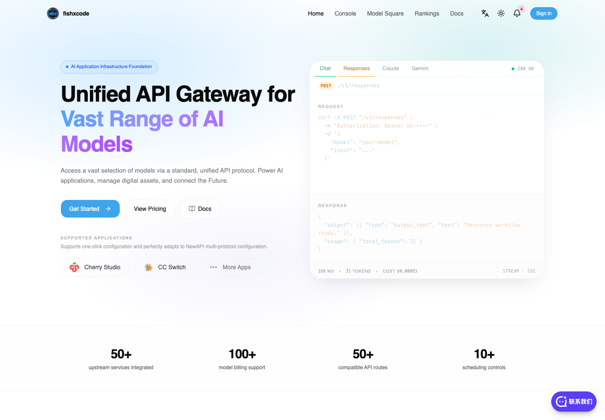
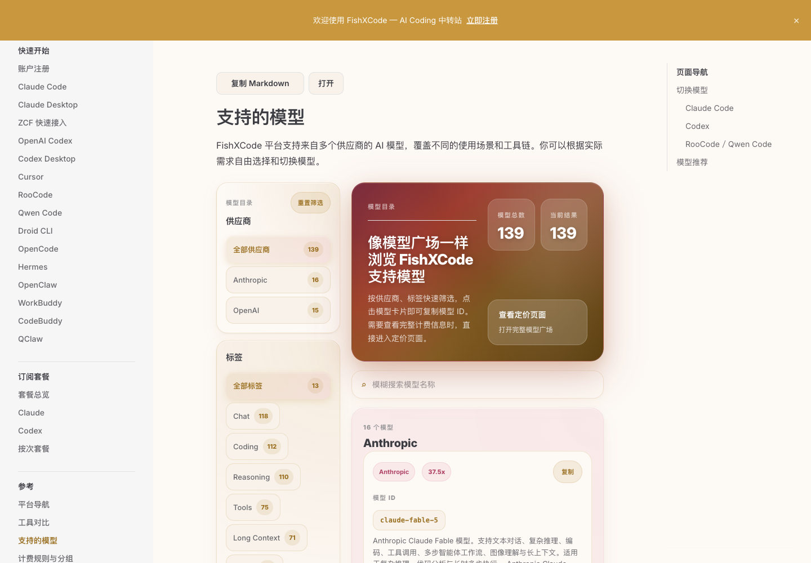
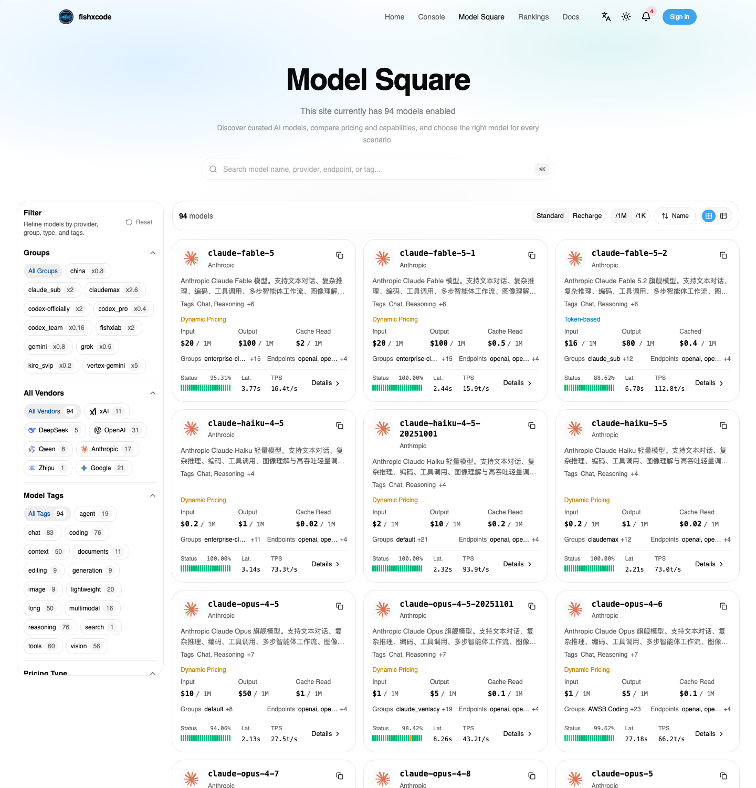
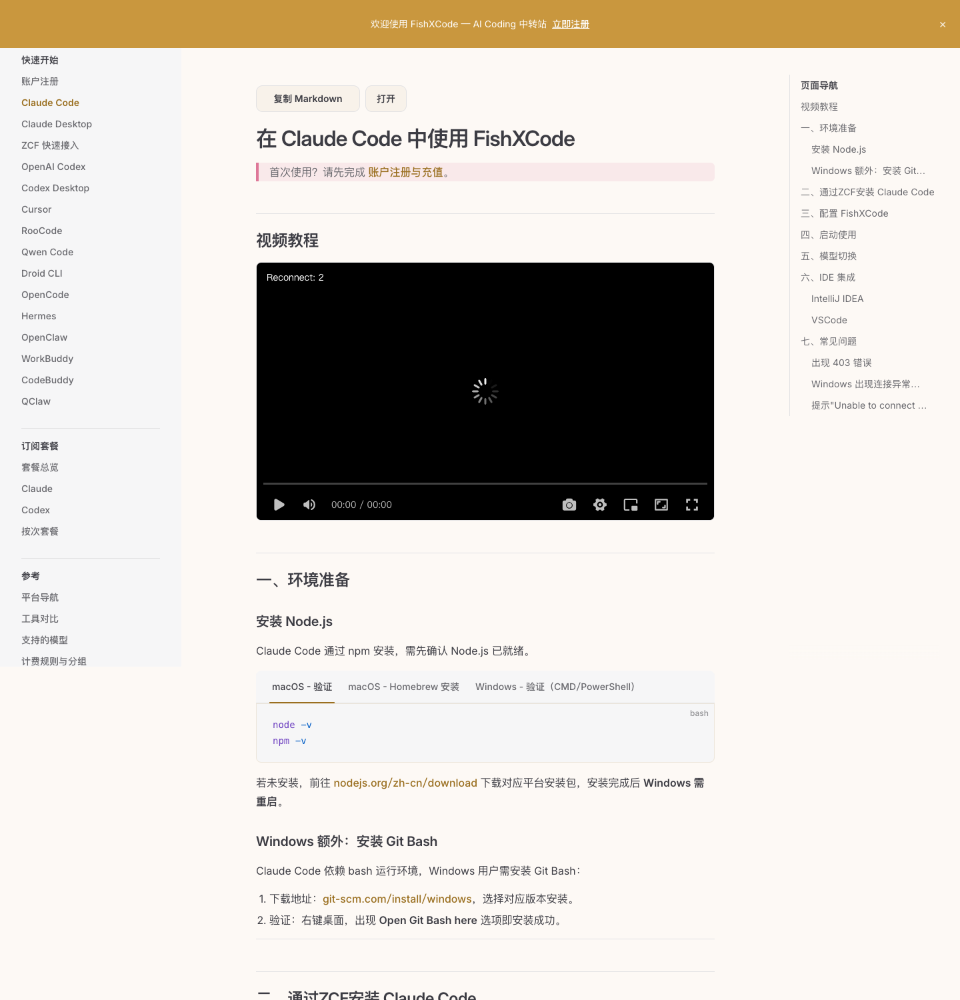
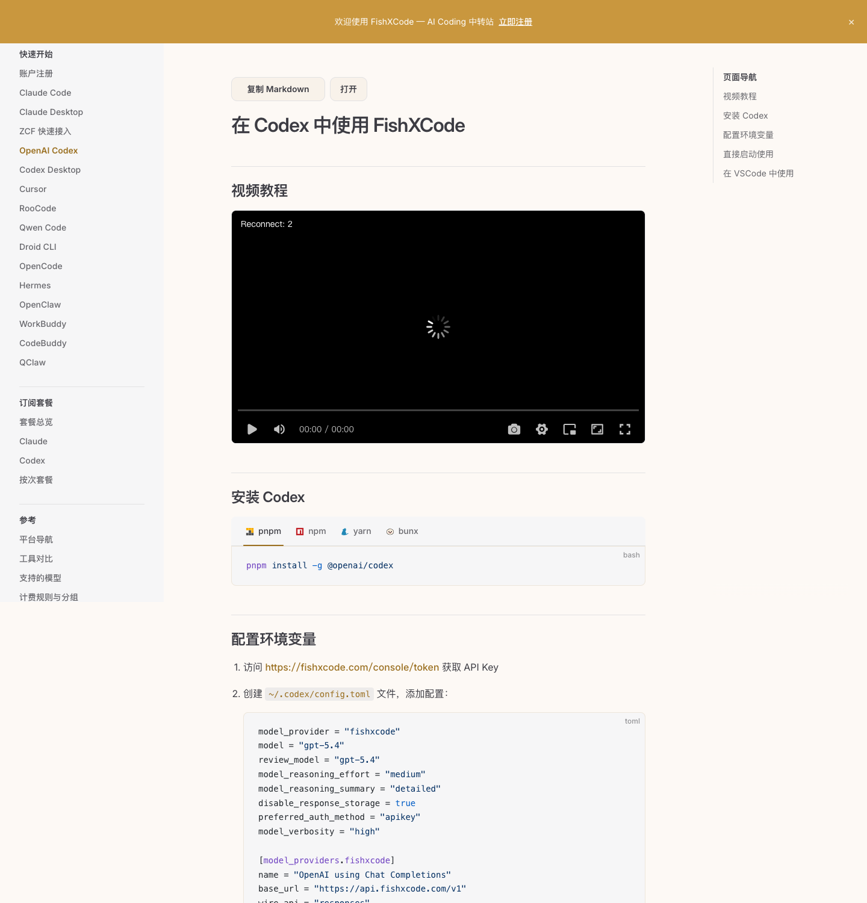

# FishXCode Review: Pay-as-You-Go vs Codex Quota vs Request Plans

**Bottom line:** FishXCode is built around AI coding rather than a generic model catalog. It offers three buying paths: wallet usage, Codex quota products, and request-count plans.

[Open FishXCode and check the current offer](https://fishxcode.com/sign-up?aff=HOvo)

## Where FishXCode fits

FishXCode is a stronger fit than a basic multi-model wallet when coding tools dominate your usage. A simple pay-as-you-go gateway remains easier for occasional, single-model calls.

International FishXCode users should distinguish wallet currency from token-price examples and confirm which payment rail appears after account login.

## Pricing and plan logic

The public catalog listed 94 enabled models on the review date. Examples include Claude Haiku 4.5 at $0.18 input / $0.90 output and Claude Sonnet 4.6 at $0.54 / $2.70 per million tokens. `codex-auto-review` was listed at $1.50 / $9.00.

FishXCode comparisons must include validity, quota expiry, request multipliers and frequency limits—not only token rates.

## Funding the account

Wallet balance supports Alipay, WeChat Pay and redemption codes. Codex products add validity periods and quota limits; request-count products add daily, monthly and total caps. Some listed Opus 4.8 and GPT-5.5 requests count as 2.5 successful requests, with a stated 10 requests/minute limit.

[Create an account and view the live checkout](https://fishxcode.com/sign-up?aff=HOvo)

## Claude Code, Codex and API setup

Claude Code uses `https://api.fishxcode.com/` as `ANTHROPIC_BASE_URL`. Codex uses `https://api.fishxcode.com/v1` in its provider configuration. Give each client its own key.

On FishXCode, tie each key to its product type; a wallet key and a Codex quota key should not be mixed in cost reports.

## Recommended rollout

1. Record one week of wallet-based coding usage.
2. Compare that usage against Codex validity and quota.
3. Check request-plan multipliers and rate limits.
4. Assign Claude Code and Codex separate product keys.
5. Buy a plan only when its allowance will be consumed.

## FAQ

### Is FishXCode a replacement for an official API account?

FishXCode can replace a generic coding relay when plan choice matters; direct vendor accounts remain the contract-first option.

### Should I use one key for every tool?

No. FishXCode keys should map to wallet, Codex quota or request-plan usage separately.

### Which model should I test first?

Begin with FishXCode wallet usage unless your recent Codex workload already proves a quota product will be consumed.

### How do I avoid unexpected spend?

For FishXCode, include quota expiry, 2.5x request counting and per-minute limits in the budget calculation.

## Verdict

FishXCode is built around AI coding rather than a generic model catalog. It offers three buying paths: wallet usage, Codex quota products, and request-count plans. FishXCode is a stronger fit than a basic multi-model wallet when coding tools dominate your usage. A simple pay-as-you-go gateway remains easier for occasional, single-model calls.

[Visit FishXCode and compare the live pricing](https://fishxcode.com/sign-up?aff=HOvo)

Fish search terms

FishXCode review · FishXCode pricing · FishXCode signup · Claude Code API relay · Codex API gateway · AI API proxy

---

*Fish page checked November 19, 2026; recheck the live catalog and checkout before purchase.*
